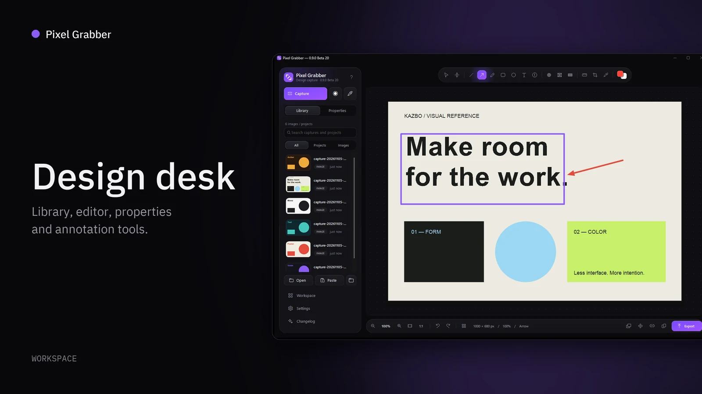
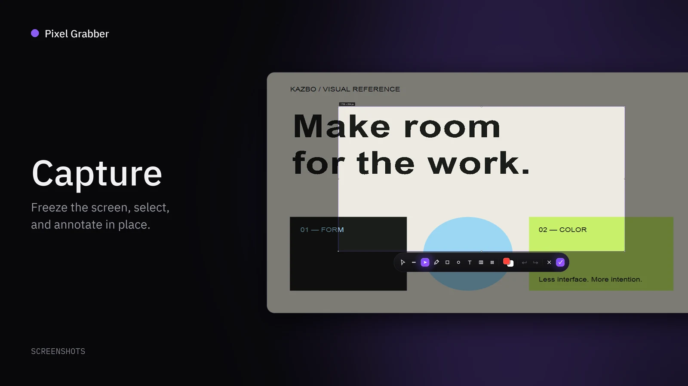
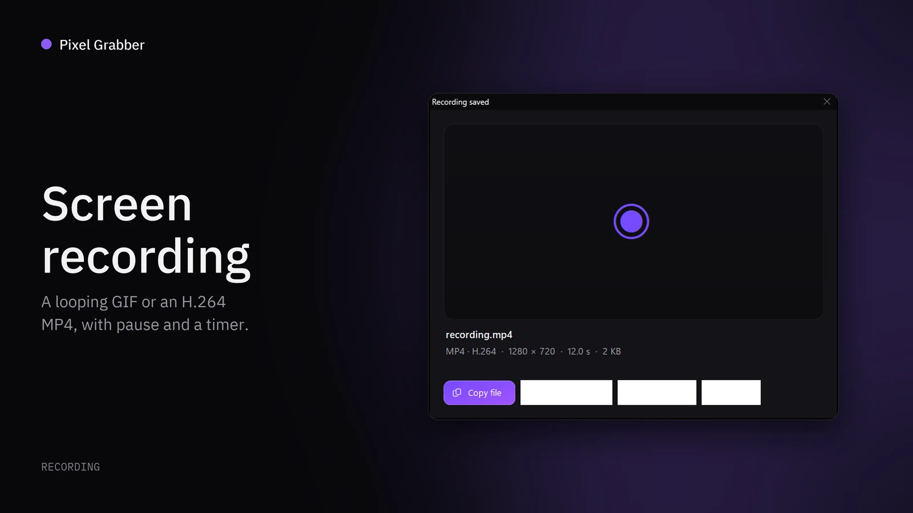
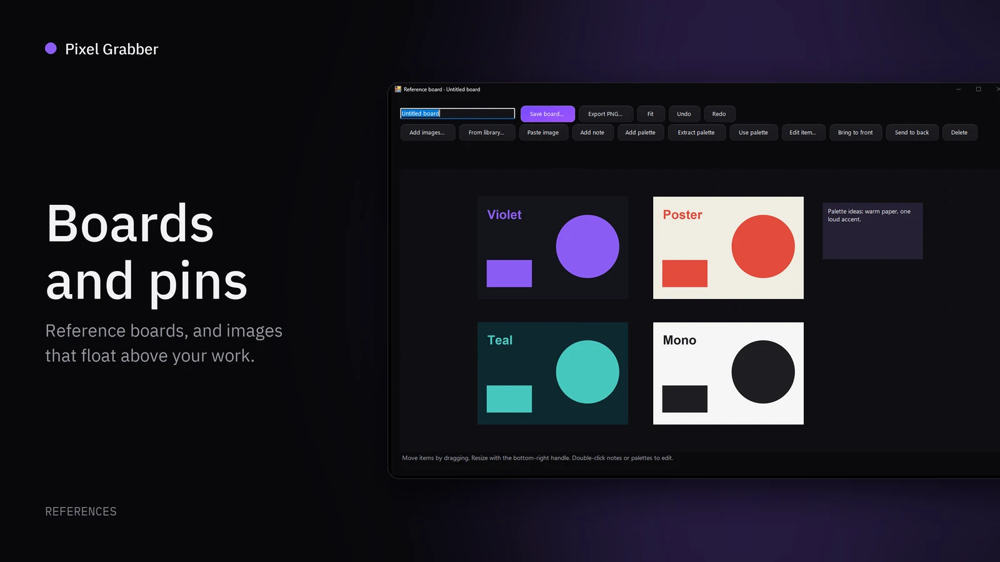

<div align="center">


# Pixel Grabber Installer

**Windows installer downloads for Pixel Grabber, a screenshot, color and reference tool for graphic designers.**

<table>
<tr>
<td width="50%" valign="top">
<a href="https://github.com/KazboXIII/PixelGrabber#design-desk"></a>
<br/><a href="https://github.com/KazboXIII/PixelGrabber#design-desk"><strong>Design desk</strong></a>
<br/><sub>Annotate and keep every capture</sub>
</td>
<td width="50%" valign="top">
<a href="https://github.com/KazboXIII/PixelGrabber#capture"></a>
<br/><a href="https://github.com/KazboXIII/PixelGrabber#capture"><strong>Capture</strong></a>
<br/><sub>Select and annotate on screen</sub>
</td>
</tr>
<tr>
<td width="50%" valign="top">
<a href="https://github.com/KazboXIII/PixelGrabber#screen-recording"></a>
<br/><a href="https://github.com/KazboXIII/PixelGrabber#screen-recording"><strong>Screen recording</strong></a>
<br/><sub>GIF or H.264 MP4</sub>
</td>
<td width="50%" valign="top">
<a href="https://github.com/KazboXIII/PixelGrabber#boards-and-pins"></a>
<br/><a href="https://github.com/KazboXIII/PixelGrabber#boards-and-pins"><strong>Boards and pins</strong></a>
<br/><sub>Floating references</sub>
</td>
</tr>
</table>

[](https://github.com/KazboXIII/PixelGrabber-Installer/releases/latest)
[](https://github.com/KazboXIII/PixelGrabber-Installer/releases)
[](#requirements)

**[Download the latest installer](https://github.com/KazboXIII/PixelGrabber-Installer/releases/latest)** · [See every menu and feature](https://github.com/KazboXIII/PixelGrabber) · [Full release notes](https://github.com/KazboXIII/PixelGrabber/releases)

</div>

---

## Install

| Step | What to do |
|---|---|
| 1 | Download `PixelGrabber-<version>-Setup-x64.exe` from the [latest release](https://github.com/KazboXIII/PixelGrabber-Installer/releases/latest). |
| 2 | Run it. Windows may warn that the installer is unsigned; choose **More info > Run anyway**. |
| 3 | Pixel Grabber starts in the system tray. Press Ctrl+Shift+2 to capture a region. |

Once installed, Pixel Grabber updates itself from [KazboXIII/PixelGrabber](https://github.com/KazboXIII/PixelGrabber/releases), which also has full release notes.

Each release includes `SHA256SUMS.txt` so you can check the download:

```powershell
Get-FileHash .\PixelGrabber-<version>-Setup-x64.exe -Algorithm SHA256
```

## Requirements

| Needs | Details |
|---|---|
| Windows | Windows 10 1809 or newer, or Windows 11 |
| Processor | Intel or AMD x64 |
| Runtime | .NET Framework 4.8 |
